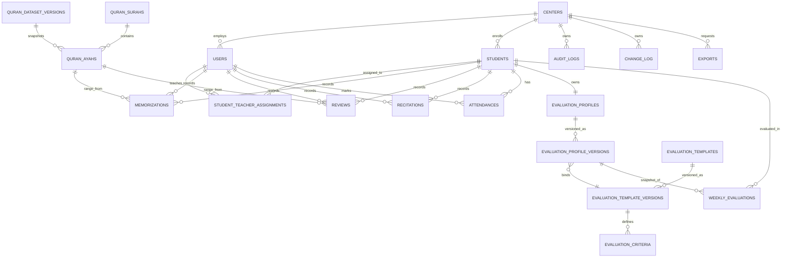

# Tahfeez — Database Design

Status: **Draft for review** · Phase 0
Target: PostgreSQL 16 · All timestamps `timestamptz` (UTC) · All business decimals `numeric`

---

## 1. Design principles

1. **`center_id` is the tenant boundary.** Every tenant table carries it, every composite index leads with it, every unique constraint includes it.
2. **Two key spaces.** Server `bigint` identity (internal, indexed, FK target) + client `uuid` (`client_uuid`, nullable, unique per center) for offline-created rows. See ADR-0006.
3. **Immutable history.** Records that feed grades are never hard-deleted: `deleted_at` soft delete, plus `version` integer for optimistic concurrency.
4. **Snapshots over joins.** Anything that explains a historical score is copied into the evaluation row, not recomputed later.
5. **Quran data is versioned reference data.** No `center_id`, no writes at runtime. Each import creates an immutable snapshot; rows are keyed by `(dataset_version_id, …)` and historical records point at the snapshot they were measured with.
6. **Enums as `varchar` + `CHECK`**, not PG enums — adding a value must not require a table rewrite lock.

---

## 2. Entity–relationship overview

---

## 3. Tenancy & identity

### `centers`
| Column | Type | Notes |
|---|---|---|
| id | bigint PK | |
| name | varchar(160) | |
| slug | varchar(80) | unique |
| timezone | varchar(64) | IANA, e.g. `Asia/Riyadh` |
| locale | varchar(5) | `ar` / `en` default |
| weekly_evaluation_start_day | varchar(10) | enum `WeekStartDay`: `saturday`…`friday`. Setting, not a rule. New centers default to `saturday` (current center) |
| weekly_evaluation_start_day_effective_from | date | the setting applies only to weeks starting on/after this date; historical weeks keep their stored boundaries |
| settings | jsonb | default-required pages, rounding policy, feature toggles |
| is_active | boolean | |
| created_at / updated_at | timestamptz | |
| deleted_at | timestamptz | soft delete |

Future: `region_id` nullable FK added when regions ship (BR-TEN-03). No shape change required.

### `users`
| Column | Type | Notes |
|---|---|---|
| id | bigint PK | |
| center_id | bigint FK → centers | |
| name | varchar(160) | |
| email | citext | unique per center |
| phone | varchar(32) null | |
| password | varchar(255) | bcrypt/argon2 |
| locale | varchar(5) | |
| is_active | boolean | |
| last_login_at | timestamptz null | |
| created_at / updated_at / deleted_at | timestamptz | |

Constraints: `unique (center_id, email)` · `index (center_id, is_active)`

### `roles` / `permissions` (spatie, center-scoped)
Standard package tables plus `roles.center_id`. A role belongs to a center, so a manager cannot grant a role from another tenant. `model_has_roles` carries `center_id` as the team key.

### `devices`
| Column | Type | Notes |
|---|---|---|
| id | bigint PK | |
| user_id | bigint FK | |
| device_uuid | uuid | unique per user |
| platform | varchar(16) | android / ios / web |
| app_version | varchar(24) | |
| last_seen_at | timestamptz | |
| revoked_at | timestamptz null | |

Tokens are Sanctum `personal_access_tokens` bound to a device; revoking the device revokes its tokens.

---

## 4. Students

### `students`
| Column | Type | Notes |
|---|---|---|
| id | bigint PK | |
| center_id | bigint FK | |
| code | varchar(24) null | human-readable serial per center |
| full_name | varchar(160) | |
| birth_date | date null | preferred age source **[OD-001]** |
| age_years | smallint null | fallback when DOB unknown |
| grade_level | varchar(64) null | free text or lookup **[OD-016]** |
| phone | varchar(32) null | |
| guardian_name | varchar(160) | |
| guardian_phone | varchar(32) null | |
| enrolled_at | date | immutable (BR-STU-03) |
| status | varchar(16) | `active` \| `inactive` |
| notes | text null | |
| client_uuid | uuid null | |
| version | integer | optimistic concurrency |
| created_at / updated_at / deleted_at | timestamptz | |

Constraints: `unique (center_id, client_uuid)` · `unique (center_id, code)` · `index (center_id, status)` · `index (center_id, full_name)` (trigram for search)

### `student_teacher_assignments`
| Column | Type | Notes |
|---|---|---|
| id | bigint PK | |
| center_id | bigint FK | |
| student_id | bigint FK | |
| teacher_id | bigint FK → users | |
| assigned_at | date | |
| unassigned_at | date null | null = active |
| assigned_by | bigint FK → users | |
| reason | varchar(255) null | |

Constraints:
- `unique index (student_id) where unassigned_at is null` → at most one active teacher (BR-STU-04)
- `index (center_id, teacher_id, unassigned_at)` → "my students" queries
- `check (unassigned_at is null or unassigned_at >= assigned_at)`

**Why a history table and not `students.teacher_id`:** teacher performance reports (§17) need the assignment that was active *at the time of the record*. A single FK would silently rewrite history when a student is reassigned.

---

## 5. Quran master data (global, read-only, versioned)

Every table below is keyed by `dataset_version_id`. There is no unversioned Quran table, so no query can accidentally mix two datasets.

### `quran_dataset_versions`
| Column | Type | Notes |
|---|---|---|
| id | bigint PK | |
| source | varchar(32) | `kfgqpc` (primary source, ADR-0008) |
| source_url | varchar(255) | exact URL of the artifact |
| source_version | varchar(64) | as published by the source |
| edition | varchar(32) | `madinah_1405h` / `madinah_1441h` / … — coordinates are edition-specific (BR-QRN-10) |
| source_format | varchar(8) | `csv`/`json`/`sql`/`xml`/`txt`/`xlsx` |
| downloaded_at / imported_at | timestamptz | |
| checksum_sha256 | char(64) | of the raw artifact |
| validation_status | varchar(12) | `pending`/`passed`/`failed` |
| validation_report | jsonb | per-check results V-01…V-12 |
| is_active | boolean | exactly one true — partial unique index |
| notes | text | |

Constraints: `unique index (is_active) where is_active` · `index (source, source_version)`

### `quran_surahs`
PK `(dataset_version_id, id)` · `name_ar` · `name_en` · `name_transliteration` null · `revelation_place` null · `ayah_count` · `page_start` · `page_end`

`revelation_place` and `name_transliteration` are nullable because they are **not** in the official field list; they are populated only if the source provides them.

### `quran_pages`
| Column | Type | Notes |
|---|---|---|
| dataset_version_id | bigint | part of PK |
| page_number | smallint | part of PK |
| juz_number | smallint null | from `jozz` where available |
| hizb_number / rub_number | smallint null | not in the official field list — never guessed |
| lines_count | smallint | **derived from the dataset**, not assumed |
| line_offset | integer | Σ `lines_count` of previous pages; audit/ordering only |

Constraints: PK `(dataset_version_id, page_number)` · `check (lines_count > 0)`

There is no `15` constant anywhere in the schema. Page height is data (BR-QRN-09).

### `quran_ayahs`
| Column | Type | Notes |
|---|---|---|
| dataset_version_id | bigint | part of PK |
| id | integer | part of PK — global ayah id 1…6236 |
| surah_id | smallint | |
| number_in_surah | smallint | from `aya_no` |
| text_uthmani | text | from `aya_text_unicode`, stored verbatim |
| page_start / line_start | smallint | from `page` / `line_start` |
| page_end / line_end | smallint | normalised across page breaks (`quran-data.md` §6) |
| juz_number | smallint null | from `jozz` |
| is_sajda | boolean | |

Constraints: PK `(dataset_version_id, id)` · `unique (dataset_version_id, surah_id, number_in_surah)` · `index (dataset_version_id, page_start, line_start)`

**Critical:** an ayah is not guaranteed to sit on a single page. The official row carries one `page` plus `line_start`/`line_end`; the importer normalises any overflow into `page_end`/`line_end`, and records the count of such ayahs in the validation report. Storing a single page number would make range measurement ambiguous.

### `quran_active_version`
Not a table — a single cached pointer (`QuranContext`) resolved once per request from `quran_dataset_versions.is_active`. Every Quran read goes through it.

**Deliberately absent:** line widths, gap widths, stretch factors, font-feature tags, per-word coordinates, page images. Those are rendering concerns (level D) and belong in a separate static asset, never in the measurement schema (BR-QRN-11, ADR-0009).

---

## 6. Records: memorization, review, recitation

All three share a measurement block and an assessment block. They are **separate tables** because they have different lifecycles and different reports (BR-REV-01).

### Shared columns (repeated per table, documented once)

| Column | Type | Notes |
|---|---|---|
| center_id | bigint | tenant |
| student_id | bigint FK | |
| teacher_id | bigint FK → users | author of the record |
| session_date | date | center-local business date |
| surah_id | smallint FK | |
| from_ayah_id / to_ayah_id | integer FK null | nullable in MANUAL path |
| from_page / to_page | smallint null | derived, stored for reporting |
| amount_pages | numeric(8,4) | canonical amount |
| amount_lines | integer null | present when `CALCULATED` |
| amount_source | varchar(10) | `CALCULATED` \| `MANUAL` |
| quran_dataset_version_id | bigint FK null | the snapshot used for measurement; null only for `MANUAL` records without a range |
| grade | varchar(16) null | `excellent`/`very_good`/`good`/`needs_review` |
| hifz_errors | smallint null | |
| tajweed_errors | smallint null | |
| reading_errors | smallint null | |
| notes | text null | |
| client_uuid | uuid null | |
| version | integer | |
| created_at / updated_at / deleted_at | timestamptz | |

Constraints on each table:
- `unique (center_id, client_uuid)`
- `index (center_id, student_id, session_date desc)` — the hot path for student timelines
- `index (center_id, teacher_id, session_date desc)` — teacher activity
- `index (center_id, session_date)` — daily/attendance views
- `check (amount_pages >= 0)` · `check (amount_source in ('CALCULATED','MANUAL'))`
- `check (from_ayah_id is null or to_ayah_id >= from_ayah_id)`

### `memorizations`
Shared columns + `week_key date` — a **denormalised index hint only**, filled on write from the period in force at that moment.

`week_key` MUST NOT be used for aggregation. The evaluation engine groups by `session_date BETWEEN week_start AND week_end` using the period boundaries **stored on the evaluation row**, so changing `weekly_evaluation_start_day` later cannot silently re-bucket historical records (BR-EVL-16).

### `reviews`
Shared columns + `week_key date`.

### `recitations`
Shared columns, minus `from_page/to_page` in the simple path, plus:
- `recitation_type` varchar(24): `new_memorization` \| `review` \| `consolidation` **[OD-006]**
- `memorization_id` / `review_id` nullable FK (when attached)
- `rule_set_id` bigint FK null — rule set version used for scoring
- `computed_score` numeric(6,2) null — 0..100, produced by the rule engine

### `rule_sets`
`id` · `center_id` · `code` · `version` · `rules` jsonb · `is_active` · `published_at` · `created_by`

Holds the configurable mapping `grade + error counts → score` (§14). Immutable once published; new rules ⇒ new version.

---

## 7. Attendance

### `attendances`
| Column | Type | Notes |
|---|---|---|
| id | bigint PK | |
| center_id | bigint FK | |
| student_id | bigint FK | |
| teacher_id | bigint FK | recorded by |
| attendance_date | date | |
| status | varchar(20) | `present`/`excused_absence`/`unexcused_absence`/`late` |
| late_minutes | smallint null | |
| notes | text null | |
| client_uuid | uuid null | |
| version | integer | |
| created_at / updated_at / deleted_at | timestamptz | |

Constraints:
- `unique (center_id, student_id, attendance_date)` — one record per student/day (BR-ATT-03)
- `check (status <> 'late' or late_minutes is null or late_minutes >= 0)`
- `index (center_id, attendance_date, status)`

The unique constraint is also the conflict detector for sync: two devices submitting the same day collide deterministically instead of creating duplicates.

---

## 8. Evaluation

### `evaluation_templates`
`id` · `center_id` · `name` · `description` · `active_version_id` null · timestamps · soft delete

### `evaluation_template_versions`
| Column | Type | Notes |
|---|---|---|
| id | bigint PK | |
| center_id | bigint FK | |
| template_id | bigint FK | |
| version_number | integer | unique per template |
| status | varchar(12) | `draft` \| `published` \| `archived` |
| checksum | varchar(64) | hash of the criteria set |
| published_at | timestamptz null | |
| created_by | bigint FK | |

Immutability: rows with `status = published` reject updates at the application layer **and** via a DB trigger (`reject_published_version_mutation`).

### `evaluation_criteria`
| Column | Type | Notes |
|---|---|---|
| id | bigint PK | |
| template_version_id | bigint FK | |
| key | varchar(48) | `memorization_pages`, `recitation_quality`, `error_rate`, `attendance`, `review_completion` |
| label_ar / label_en | varchar(96) | |
| calculator | varchar(48) | registered calculator id (whitelist) |
| weight | numeric(5,2) | |
| params | jsonb | thresholds, caps, missing-data policy |
| sort_order | smallint | |

Constraints: `check (weight > 0 and weight <= 100)` · `unique (template_version_id, key)`
Publish-time validation (in `PublishTemplateVersion` action, covered by tests): `SUM(weight) = 100.00` exactly (BR-EVL-06).

### `evaluation_profiles`
`id` · `center_id` · `student_id` unique · `active_version_id` null · timestamps

### `evaluation_profile_versions`
| Column | Type | Notes |
|---|---|---|
| id | bigint PK | |
| center_id | bigint FK | |
| profile_id | bigint FK | |
| version_number | integer | |
| template_version_id | bigint FK | |
| required_pages | numeric(6,2) | default 1.00 (BR-EVL-01) |
| params | jsonb | per-student overrides |
| effective_from | date | |
| effective_to | date null | |
| created_by | bigint FK | |
| reason | varchar(255) | why the profile changed |
| snapshot | jsonb | full resolved rules at creation time |

Constraints: `unique (profile_id, version_number)` · `index (profile_id, effective_from desc)`
Immutability: no updates after creation; a change inserts a new version and closes the previous one (BR-EVL-09).

### `weekly_evaluations`
| Column | Type | Notes |
|---|---|---|
| id | bigint PK | |
| center_id | bigint FK | |
| student_id | bigint FK | |
| week_start / week_end | date | center-local; **stored period boundaries, never recomputed** (BR-EVL-16) |
| week_start_day | varchar(10) | snapshot of the `WeekStartDay` in force when this period was opened |
| profile_version_id | bigint FK | |
| template_version_id | bigint FK | |
| required_pages | numeric(6,2) | snapshot |
| actual_pages | numeric(8,4) | snapshot of aggregated actual |
| achievement_pct | numeric(8,2) | 250.00 for 2.5 pages @ 1 page |
| weighted_score | numeric(6,2) null | advanced template result |
| components | jsonb | per-criterion raw + normalized + weighted |
| rules_snapshot | jsonb | template, weights, calculator versions, params |
| status | varchar(12) | `draft` \| `computed` \| `approved` \| `locked` |
| revision | integer | starts at 1 |
| computed_at / approved_at | timestamptz null | |
| computed_by / approved_by | bigint FK null | |
| revision_reason | varchar(255) null | mandatory when revision > 1 |
| created_at / updated_at | timestamptz | |

Constraints:
- `unique (center_id, student_id, week_start)` — one current row per student-week
- `index (center_id, week_start, status)`
- `check (achievement_pct >= 0)` · `check (revision >= 1)`

**Why snapshot columns instead of joins:** an approved grade must remain explainable a year later even if the template was archived, a criterion renamed, or the student's profile changed. The row carries its own explanation. The same reasoning applies to the period: `week_start`, `week_end` and `week_start_day` are copied onto the row, so a later change to the center's `weekly_evaluation_start_day` cannot retroactively move a student's week.

---

## 9. Audit, sync, exports

### `audit_logs` (append-only)
`id` bigserial · `center_id` · `actor_user_id` null · `actor_device_id` null · `action` varchar(64) · `entity_type` varchar(64) · `entity_id` bigint null · `before` jsonb null · `after` jsonb null · `metadata` jsonb · `ip` inet · `user_agent` text · `request_id` uuid · `op_id` uuid null · `created_at`

No `updated_at`, no `deleted_at`. Revoked at the DB role level: the application role has `INSERT` only. `index (center_id, created_at desc)` · `index (center_id, entity_type, entity_id)`

### `change_log` (sync feed)
`seq` bigserial PK · `center_id` · `entity_type` · `entity_id` · `operation` (`create`/`update`/`delete`) · `version` · `payload` jsonb · `changed_at` · `actor_user_id` · `op_id`

`index (center_id, seq)` — pull cursor. Pruned by retention job; clients past the window full-resync (BR-SYN-08).

### `sync_operations` (idempotency ledger)
`op_id` uuid PK · `center_id` · `user_id` · `device_id` · `entity_type` · `entity_id` null · `result` (`applied`/`duplicate`/`conflict`/`rejected`) · `error` jsonb null · `applied_at`

### `exports`
`id` · `center_id` · `requested_by` · `type` · `params` jsonb · `status` (`queued`/`processing`/`ready`/`failed`) · `file_path` · `expires_at` · `error` text null · timestamps

---

## 10. Index strategy

| Query | Index |
|---|---|
| Student list / search | `(center_id, status)` + trigram on `full_name` |
| Teacher's students | `(center_id, teacher_id, unassigned_at)` |
| Student timeline | `(center_id, student_id, session_date desc)` on each record table |
| Weekly aggregation | `(center_id, student_id, week_key)` |
| Weekly evaluation lookup | `unique (center_id, student_id, week_start)` |
| Attendance day sheet | `(center_id, attendance_date, status)` |
| Sync pull | `(center_id, seq)` |
| Audit investigation | `(center_id, entity_type, entity_id)` |

Rules: no index without a named query; every new endpoint must state which index serves it (checked in code review).

---

## 11. Deletion & retention

| Entity | Delete semantics |
|---|---|
| Student | soft delete, manager only, audited |
| Memorization / Review / Recitation | soft delete, audited; never physically removed while an approved evaluation references it |
| Attendance | soft delete, audited |
| Weekly evaluation (approved) | never deleted; superseded by revision |
| Template version (published) | archived, never deleted |
| Audit log | never deleted (retention policy = append-only) |
| Export file | TTL expiry, row retained |

---

## 12. Migration order (dependency-safe)

1. `centers`
2. `users`, roles/permissions, `devices`
3. `quran_dataset_versions` → `quran_surahs` → `quran_pages` → `quran_ayahs` (all version-keyed, FK to the dataset version)
4. `students`, `student_teacher_assignments`
5. `memorizations`, `reviews`, `rule_sets`, `recitations`
6. `attendances`
7. `evaluation_templates` → `evaluation_template_versions` → `evaluation_criteria`
8. `evaluation_profiles` → `evaluation_profile_versions`
9. `weekly_evaluations`
10. `audit_logs`, `change_log`, `sync_operations`, `exports`

Each migration is independently reversible except the Quran seed (data, re-importable).
